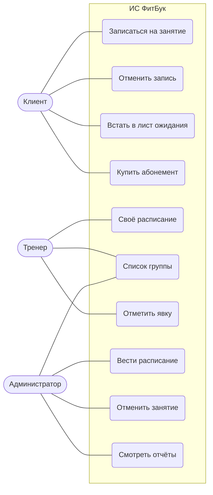
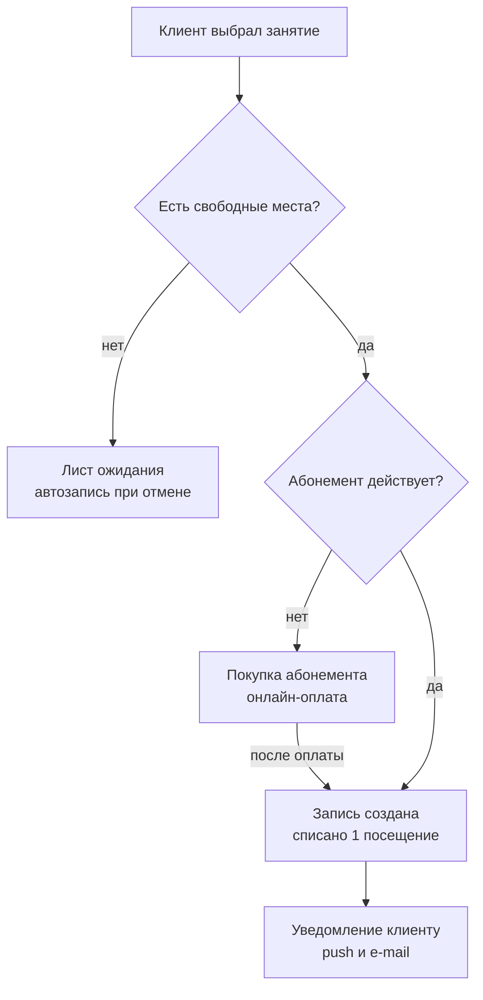
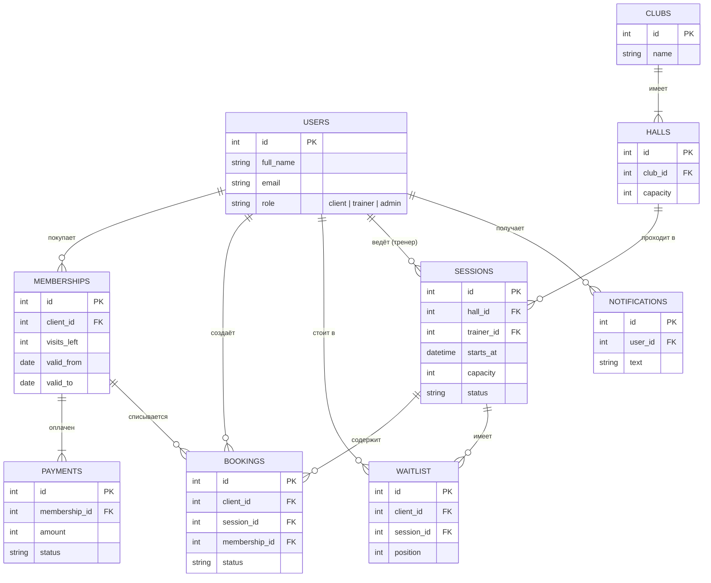

# ФитБук

ФитБук — информационная система онлайн-записи на групповые занятия для сети фитнес-клубов. Это учебный проект: бизнес-требования, три диаграммы и рабочее веб-приложение на Flask и SQLite.

## Быстрый старт

Нужен Python 3.10 или новее.

```bash
python -m venv .venv
# Windows
.venv\Scripts\activate
# macOS / Linux
source .venv/bin/activate

pip install -r requirements.txt
python run.py
```

Откройте http://127.0.0.1:5000. При первом запуске создаётся база `instance/fitbook.db` с демо-данными. Чтобы начать заново, удалите этот файл.

Вход без пароля: на первом экране выберите демо-пользователя.

| Пользователь | Роль | Что на нём показать |
|---|---|---|
| Ольга Иванова | клиент | есть абонемент и две записи |
| Дмитрий Орлов | клиент | абонемент истёк: запись не пройдёт, система предложит купить новый |
| Екатерина Белова, Сергей Ким | клиенты | записаны в полную группу «Бокс» |
| Игорь Петров | тренер | его «Сайкл» идёт прямо сейчас — можно отметить явку |
| Наталья Соколова | администратор | расписание, отмена занятий, отчёты |

Сценарий «лист ожидания»:
1. Войти Ольгой и встать в очередь на «Бокс».
2. Войти Екатериной и отменить свою запись на «Бокс».
3. Войти снова Ольгой: она автоматически записана, в уведомлениях есть сообщение об этом.

Тесты:

```bash
pytest
```

## Бизнес-требования

**Цели:**
- к концу первого года не меньше 70% записей идут онлайн;
- заполняемость групп растёт с 60% до 85%;
- нет посещений без оплаты.

**Роли:** клиент, тренер, администратор клуба.

| № | Требование | Где реализовано |
|---|---|---|
| БТ-1 | Расписание всех клубов на 14 дней вперёд с фильтрами по клубу, направлению, тренеру и дню | `services.schedule` |
| БТ-2 | Записаться можно только с действующим абонементом, в котором остались посещения; иначе система предлагает его купить | `services.book`, `find_membership` |
| БТ-3 | Вместимость не превышается; когда мест нет, клиент встаёт в лист ожидания | `services.book`, `join_waitlist` |
| БТ-4 | Отмена больше чем за 4 ч до начала возвращает посещение, более поздняя — сжигает его | `services.cancel_booking` |
| БТ-5 | Освободившееся место автоматически получает первый в листе ожидания, и ему приходит уведомление | `services._promote_waitlist` |
| БТ-6 | Абонемент оплачивается онлайн картой, чек уходит на e-mail (54-ФЗ) | `services.buy_membership` (оплата имитируется) |
| БТ-7 | Тренер отмечает явку с начала занятия и до 2 ч после его окончания; неявка сжигает посещение | `services.mark_attendance` |
| БТ-8 | Напоминания за 24 ч и за 2 ч до занятия | `services.send_due_reminders` |
| БТ-9 | Отчёты: заполняемость залов, популярность направлений, выручка | `services.reports` |
| БТ-10 | Отмена занятия клубом: всем записавшимся возвращаются посещения и приходит уведомление | `services.cancel_session` |

**Нефункциональные требования:**
- расписание открывается не дольше 2 с при 500 одновременных пользователях;
- доступность — 99,5%;
- персональные данные обрабатываются по 152-ФЗ, доступ разграничен по ролям;
- есть веб-версия и мобильное приложение.

## Диаграммы

### 1. Варианты использования



### 2. Процесс записи на занятие



### 3. Модель данных



## Устройство

```
app/
  __init__.py   фабрика приложения, создание и наполнение БД
  schema.sql    схема БД
  db.py         подключение к SQLite и демо-данные
  services.py   бизнес-правила БТ-1…БТ-10
  api.py        REST API (/api/...)
  static/       одностраничный интерфейс на чистом JS, без сборки
tests/          pytest: правила и сквозные сценарии API
run.py          запуск dev-сервера
```

- Все правила собраны в `services.py`. Функции получают текущее время параметром, поэтому граничные случаи («ровно 4 часа», «через 2 часа после конца») проверяются тестами.
- Запись на занятие идёт в транзакции `BEGIN IMMEDIATE`: двое клиентов не займут одно последнее место.
- Напоминания (БТ-8) рассылаются при обращении к API. В рабочей системе это делал бы планировщик.

## Ограничения демо-версии

- Вход без пароля, а `SECRET_KEY` по умолчанию — заглушка. Для развёртывания задайте переменную `FITBOOK_SECRET_KEY` и добавьте настоящую аутентификацию.
- Оплата и отправка чека имитируются: платёжного шлюза и ОФД нет.
- Уведомления хранятся в приложении; push и e-mail не отправляются.
